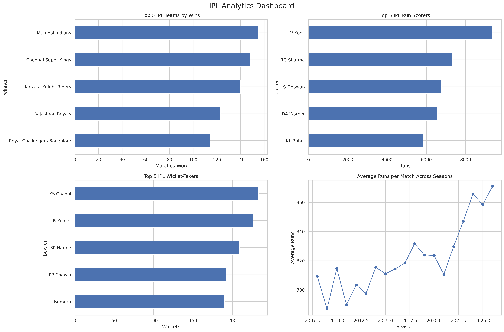
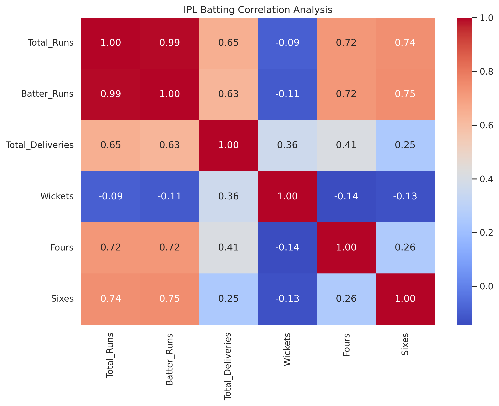

# IPL Data Analysis: Exploratory Data Analysis (EDA)

## Project Overview
This project performs Exploratory Data Analysis (EDA) on Indian Premier League (IPL) cricket data using Python. It explores team performance, player statistics, match outcomes, venue trends and scoring patterns to identify meaningful insights.

## Dataset
**Source:** Cricsheet  
**Dataset:** Men's Indian Premier League ball-by-ball data  
**Format:** JSON, processed into Pandas DataFrames.

The dataset contains match-level information and individual delivery records.

## Technologies Used
- Python
- Pandas
- NumPy
- Matplotlib
- Seaborn
- Google Colab

## Analysis Performed
1. IPL team performance and match wins
2. Top run scorers
3. Leading wicket-takers
4. Toss impact on match outcomes
5. Venue scoring analysis
6. Scoring trends across IPL seasons
7. Correlation analysis of batting factors
8. Player boundary statistics
9. Batting first versus chasing comparison

## Visualizations

### IPL Analytics Dashboard

### Correlation Heatmap

## Project Structure
- `IPL_Data_Analysis_EDA.ipynb` – Complete analysis notebook
- `visualizations/` – Generated charts and dashboard
- `reports/` – Exported statistical analysis tables

## Key Findings
The project investigates historical team performance, leading batting and bowling records, toss outcomes, venue scoring patterns and changes in IPL scoring trends.

Detailed findings are available in the notebook and exported reports.

## Conclusion
This project demonstrates how Exploratory Data Analysis can be used to understand cricket statistics, discover patterns and communicate data-driven insights through visualizations.

## Disclaimer
This project is developed for educational and analytical purposes. Statistics reflect the downloaded Cricsheet dataset and its coverage.
